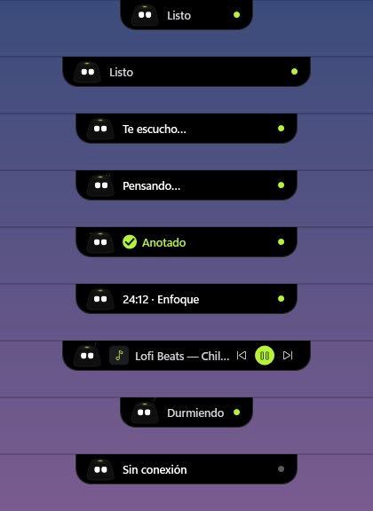
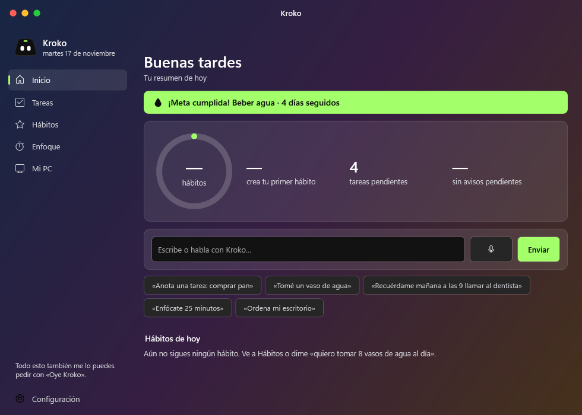
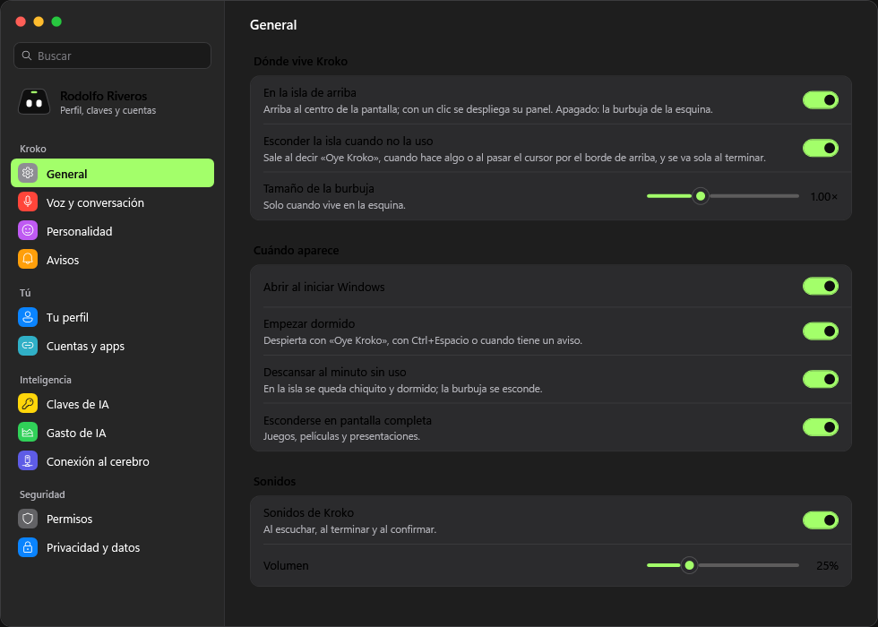
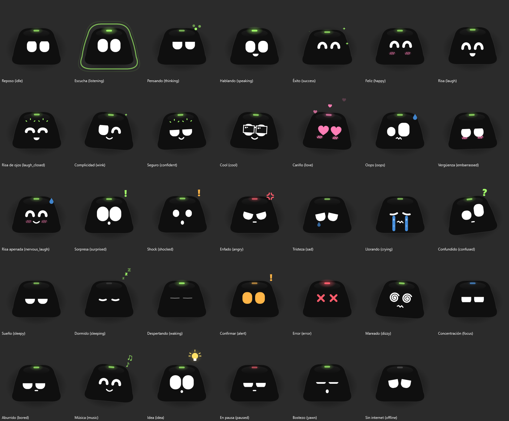

# Kroko

Compañero de escritorio para Windows: vive en una isla arriba de tu pantalla, con cara expresiva. Le hablas («Oye Kroko»)
y controla tu PC, tus tareas, tu correo, tu calendario y tus apps. El cerebro vive en un servidor y la App en tu PC.



| Su panel | Configuración |
|---|---|
|  |  |



## Qué hace

- **Habla contigo:** «Oye Kroko», el atajo `Ctrl+Espacio` o escribiéndole; responde con la voz de Gemini (también en tiempo real).
- **Controla tu PC:** abre programas y archivos, ordena carpetas (con «Deshacer»), volumen, brillo, apagar, capturas,
  clics y teclado en cualquier ventana. Lo irreversible siempre pide permiso.
- **Suelta archivos sobre Kroko:** convertir imágenes (PNG, JPG, a PDF) y audio, analizarlos con Gemini, ordenarlos o
  mandarlos a tu Telegram o a tu celular con un QR (por tu Wi-Fi, un solo uso).
- **Música en la isla:** lo que suena en Spotify, YouTube o el navegador, con portada y botones; la cara se pone a bailar.
- **Tu día:** tareas, recordatorios, hábitos con racha, enfoque (pomodoro), correo, Notion, Google, Trello, Todoist.
- **Asistente proactivo:** hasta 3 avisos útiles al día por Telegram (resumen, pendientes, sugerencias).
- **IA mixta:** lo simple lo piensa tu PC (Qwen 3 4B con llama.cpp, opcional) y lo difícil Gemini.
- **Vive donde quieras:** en la isla de arriba (se esconde sola), en la esquina o libre por el escritorio.

## Descargar Kroko (Windows 10/11)

**[⬇ Descargar el instalador (KrokoApp-win-Setup.exe)](https://github.com/rodolfo-riveros/kroko/releases/latest/download/KrokoApp-win-Setup.exe)**
· [todas las versiones](https://github.com/rodolfo-riveros/kroko/releases)

Se instala sin permisos de administrador y se actualiza sola. Si Windows dice "Windows protegió su PC", pulsa
**Más información → Ejecutar de todas formas** (el instalador aún no tiene firma digital). Al abrirla te pide la
dirección de tu cerebro (servidor) y su token.

**¿Qué va al servidor?** Nada compilado: el servidor descarga solo la imagen del cerebro (`ghcr.io/rodolfo-riveros/kroko-brain`).
Solo necesitas la carpeta `deploy/` (con tu `.env`). Guías: [VPS propio](docs/VPS-PROPIO.md) · [Oracle gratis](docs/SERVIDOR-GRATIS.md).

## Qué hay en este repositorio

| Carpeta | Qué es | Dónde corre |
|---|---|---|
| `src/Kroko.App` | La App de escritorio (WPF): burbuja, voz, «Oye Kroko», herramientas de la PC, Ajustes | Tu PC (instalador con actualización automática) |
| `src/Kroko.Brain` | El cerebro (ASP.NET): IA, memoria, automatizaciones, correo, Google, Trello, Telegram | Servidor con Docker |
| `src/Kroko.Shared` | Mensajes y herramientas que comparten los dos | — |
| `deploy/` | Docker del cerebro (Caddy con HTTPS + Watchtower para actualizarse solo) | Servidor |
| `tests/` | Pruebas automáticas (cerebro y App) | GitHub Actions |
| `.github/workflows/` | Pruebas, publicación de la App, imagen del cerebro y escáner de claves | GitHub |
| `CLAUDE.md` | Documento maestro del proyecto (diseño, reglas, estado) | — |

## Tus claves nunca van al repositorio

- Las API keys y cuentas se ponen en **Configurar Kroko** (clic derecho sobre Kroko), nunca en el código.
- **Las claves de IA (Gemini, DeepSeek) viven solo en tu PC**, cifradas con Windows (`%LOCALAPPDATA%\Kroko\claves-ia.dat`):
  la App se las presta al cerebro al conectarse y el cerebro las tiene **solo en memoria** (no las lee del `.env` ni
  las guarda). Gmail, Telegram y las apps se guardan cifradas en el servidor (`/data/Kroko/secretos.dat`).
- `.env`, `secretos.dat`, bases de datos y `settings.json` están en `.gitignore` y `.dockerignore`.
- **Protección local:** activa una vez el bloqueo de commits con claves:
  ```bash
  git config core.hooksPath .githooks
  ```
- **Protección en GitHub:** el flujo *Buscar claves filtradas* (Gitleaks) revisa cada cambio. Activa además
  *Settings → Code security → Secret Protection / Push protection* en el repositorio.
- Si alguna vez se filtra una clave: **cámbiala en su servicio** (no basta con borrarla del repo).

## Publicar una versión nueva de la App (se actualiza sola en tu PC)

```bash
git tag v1.0.1
git push origin v1.0.1
```

GitHub Actions compila, prueba y sube el instalador a **Releases** (`KrokoApp-win-Setup.exe`). Kroko revisa cada
4 horas, descarga la versión nueva y se reinicia solo cuando está dormido (no interrumpe). La App se instala en
`%LOCALAPPDATA%\KrokoApp`; tus datos viven aparte en `%LOCALAPPDATA%\Kroko` (desinstalar no los borra).

## El cerebro en un servidor

Guía paso a paso **gratis** (Oracle Cloud + DuckDNS): [docs/SERVIDOR-GRATIS.md](docs/SERVIDOR-GRATIS.md). ¿Ya tienes un VPS con los puertos 80/443 ocupados? [docs/VPS-PROPIO.md](docs/VPS-PROPIO.md). ¿Para ti y tus amigos, cada uno con su cerebro? [Varias personas](docs/VPS-PROPIO.md#varias-personas-en-el-mismo-servidor-tú-y-tus-amigos). Detalles: [docs/DESPLIEGUE.md](docs/DESPLIEGUE.md). En resumen:

```bash
cd deploy && cp .env.example .env   # pon tu dominio y un token largo
docker compose up -d
```

Cada cambio en `src/Kroko.Brain` publica la imagen `ghcr.io/rodolfo-riveros/kroko-brain` y Watchtower la instala sola.

## Desarrollo

```bash
dotnet build Kroko.slnx
dotnet test tests/Kroko.Tests
dotnet test tests/Kroko.App.Tests
```

En desarrollo la App arranca un cerebro local (`http://localhost:5080`) desde el código; la App instalada solo
usa el del servidor. Herramientas útiles: `Kroko.App.exe --snapshot <carpeta>` dibuja las ventanas en PNG.
