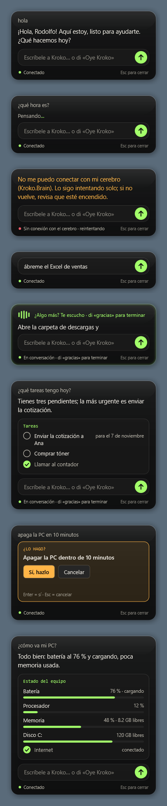

# Kroko

Compañero de escritorio para Windows: una burbuja con cara expresiva a la que le hablas («Oye Kroko») y que
controla tu PC, tus tareas, tu correo, tu calendario y tus apps. El cerebro vive en un servidor y la App en tu PC.



## Qué hay en este repositorio

| Carpeta | Qué es | Dónde corre |
|---|---|---|
| `src/Kroko.App` | La App de escritorio (WPF): burbuja, voz, «Oye Kroko», herramientas de la PC, Ajustes | Tu PC (instalador con actualización automática) |
| `src/Kroko.Brain` | El cerebro (ASP.NET): IA, memoria, automatizaciones, correo, Google, Trello, Telegram | Servidor con Docker |
| `src/Kroko.Shared` | Mensajes y herramientas que comparten los dos | — |
| `deploy/` | Docker del cerebro (Caddy con HTTPS + Watchtower para actualizarse solo) | Servidor |
| `tests/` | Pruebas automáticas (cerebro y App) | GitHub Actions |
| `.github/workflows/` | Pruebas, publicación de la App, imagen del cerebro y escáner de claves | GitHub |
| `CLAUDE.md` | Documento maestro del proyecto (diseño, reglas, estado) | — |

## Tus claves nunca van al repositorio

- Las API keys y cuentas se ponen en **Configurar Kroko** (clic derecho sobre Kroko). Se guardan **cifradas en el
  servidor** (`/data/Kroko/secretos.dat`), nunca en el código.
- `.env`, `secretos.dat`, bases de datos y `settings.json` están en `.gitignore` y `.dockerignore`.
- **Protección local:** activa una vez el bloqueo de commits con claves:
  ```bash
  git config core.hooksPath .githooks
  ```
- **Protección en GitHub:** el flujo *Buscar claves filtradas* (Gitleaks) revisa cada cambio. Activa además
  *Settings → Code security → Secret Protection / Push protection* en el repositorio.
- Si alguna vez se filtra una clave: **cámbiala en su servicio** (no basta con borrarla del repo).

## Publicar una versión nueva de la App (se actualiza sola en tu PC)

```bash
git tag v1.0.1
git push origin v1.0.1
```

GitHub Actions compila, prueba y sube el instalador a **Releases** (`KrokoApp-win-Setup.exe`). Kroko revisa cada
4 horas, descarga la versión nueva y se reinicia solo cuando está dormido (no interrumpe). La App se instala en
`%LOCALAPPDATA%\KrokoApp`; tus datos viven aparte en `%LOCALAPPDATA%\Kroko` (desinstalar no los borra).

## El cerebro en un servidor

Guía paso a paso **gratis** (Oracle Cloud + DuckDNS): [docs/SERVIDOR-GRATIS.md](docs/SERVIDOR-GRATIS.md). Detalles: [docs/DESPLIEGUE.md](docs/DESPLIEGUE.md). En resumen:

```bash
cd deploy && cp .env.example .env   # pon tu dominio y un token largo
docker compose up -d
```

Cada cambio en `src/Kroko.Brain` publica la imagen `ghcr.io/rodolfo-riveros/kroko-brain` y Watchtower la instala sola.

## Desarrollo

```bash
dotnet build Kroko.slnx
dotnet test tests/Kroko.Tests
dotnet test tests/Kroko.App.Tests
```

En desarrollo la App arranca un cerebro local (`http://localhost:5080`) desde el código; la App instalada solo
usa el del servidor. Herramientas útiles: `Kroko.App.exe --snapshot <carpeta>` dibuja las ventanas en PNG.
